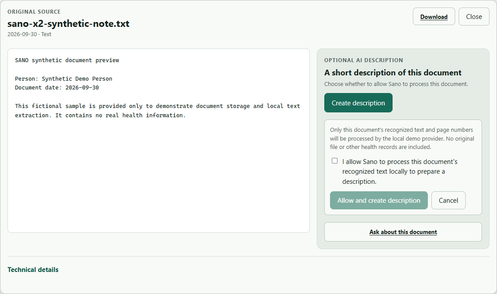
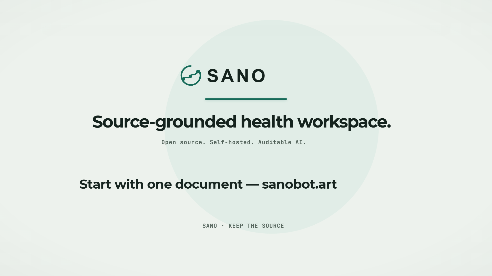

# SANO

Private, source-grounded personal and family health workspace with auditable AI.

  [Live product](https://sanobot.art)

SANO helps people keep health history together, prepare for visits, and share a Person's information through explicit family access grants. It is open-source and self-hosted. open-care-proof-kit remains the stable Python package name; opencare-* identifiers remain stable for protocols and schemas.

**Live product:** [sanobot.art](https://sanobot.art) · **Repository:** [SANO](https://github.com/KirillNedoboy/SANO)

*Fictional sample. Provider actions require explicit consent. The screenshot does not represent a live inference result.*

## What is shipped

The published main branch includes:

- Product Core schema v13 with Person-scoped sources, candidate facts, provenance, human review, canonical records, timeline, Visits, and Visit Briefs.
- SANO-X2 document understanding for PDF, TXT, JPG, and PNG, including local Tesseract OCR for Russian and English. Document summaries and Q&A are consent-gated and do not create reviewed health records.
- Family Access with explicit, revocable Person-scoped grants and separate genetics permissions.
- Genetics Workspace and bounded Evidence/Explore Research Mode with selected observations, citations, counterevidence, and research receipts.
- A guarded provider runtime with minimized context, output validation, provenance references, and Execution Receipts. AI output cannot mutate canonical records.
- Portable Trust Envelope and Agent Plugins packages, deterministic evals, and local backup/recovery workflows.

The product lifecycle is:

~~~text
user-owned source -> immutable registration -> extraction/candidate
-> provenance -> human review -> canonical record -> bounded context
-> validated answer or refusal -> audit / receipt
~~~

## See SANO in action

[Watch or download the existing 60-second promo video](https://raw.githubusercontent.com/KirillNedoboy/SANO/media/sano-promo-video/sano-promo.mp4) · 1920×1080 · 60 fps · H.264/AAC

## Run SANO locally

Requires Docker with Compose. This quickstart is for local inspection.

PowerShell:

~~~powershell
Copy-Item .env.example .env
docker compose up --build
~~~

POSIX shell:

~~~sh
cp .env.example .env
docker compose up --build
~~~

Open [http://127.0.0.1:8000/bootstrap](http://127.0.0.1:8000/bootstrap) to create the first local account. The deterministic assistant works without a provider key. External providers require operator configuration and explicit per-action consent. See the [deployment guide](docs/deployment.md) and [production deployment notes](docs/production_deployment.md).

## Stack and architecture

SANO uses Python 3.12, FastAPI, Jinja templates, SQLite Product Core, Docker Compose, local Tesseract OCR (rus+eng), provider adapters, and vanilla JavaScript. The current module map and data boundaries are in [Architecture](docs/architecture.md); the dependency rules are in [module boundaries](docs/architecture/module-boundaries.md).

## Privacy, safety, and limits

SANO keeps Product Core data in the self-hosted installation. Each action is Person-scoped and receives only selected authorized evidence. If an external model is configured, minimized context is disclosed only after explicit per-action consent, and the result is receipted. Raw genome data never enters the supported provider context. Repository fixtures, screenshots, and reviewer examples are synthetic or de-identified.

SANO is not clinically validated software, an AI doctor, diagnostic authority, treatment planner, medication or dosage authority, medication start/stop authority, or clinical decision-support system. Deployment security, backups, and access to a running installation remain under the operator's control.

## Validation status

Automated validation covers the deterministic provider path, authorization and consent contracts, output safety, provenance, receipts, evals, and the Python 3.12 repository checks. GitHub CI does not execute paid provider calls.

Local inference and the OpenRouter/DeepSeek live provider flow, including document summary/Q&A, are operator-confirmed. OpenAI live X2 is unverified. These distinctions and dated evidence are recorded in [SANO live validation](docs/sano-live-validation.md).

SANO v0.3.0 is the published stable release dated 8 October 2026; see the [release notes](docs/releases/v0.3.0.md). Dated technical validation and current product status remain in [SANO live validation](docs/sano-live-validation.md) and [project status](docs/project-status.md).

Release and operations references: [changelog](CHANGELOG.md), [v0.3.0 release notes](docs/releases/v0.3.0.md), [v0.1.0 private-alpha notes](docs/releases/v0.1.0-private-alpha.md), and the [private-alpha operator checklist](docs/private-alpha-operator-checklist.md).

## Documentation and contribution

Use the [documentation index](docs/README.md) to find current status, capabilities, architecture, validation, security, deployment, reviewer guides, and the completed roadmap. Start with the [judge guide](docs/judge-guide.md) for a short product walkthrough, [capability matrix](docs/capability-matrix.md) for feature boundaries, and [security reporting](SECURITY.md) for disclosures.

Contributions follow [CONTRIBUTING.md](CONTRIBUTING.md) and the repository instructions in [AGENTS.md](AGENTS.md). SANO is licensed under [Apache-2.0](LICENSE).
